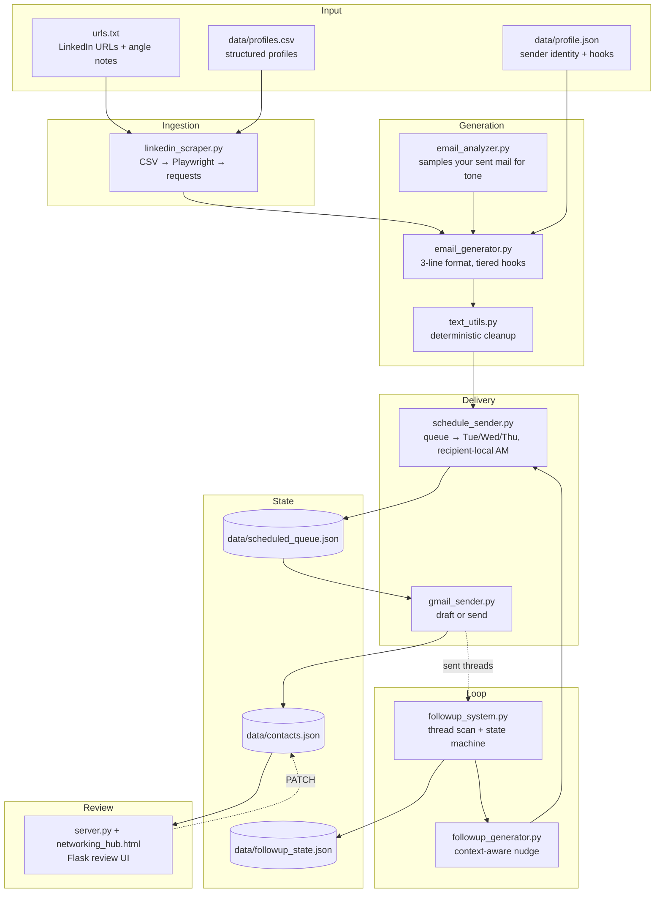

# outreach-engine

A command-line system for researched, personalized cold outreach at small scale. It reads a
list of people you want to talk to, drafts a tightly-constrained email for each one with
Claude, holds each message until a sensible hour **in the recipient's timezone**, sends it
through the Gmail API, and then tracks replies well enough to know who deserves a follow-up
and who does not.

It was built for finance recruiting outreach, but nothing in the pipeline is finance-specific
— the voice, the credibility hooks, and the sender identity all come from a config file.

> **On data:** every data file in this repository is synthetic. Real contact lists, queues,
> and reply state are gitignored and never leave the machine that runs the tool. See
> [Data & privacy](docs/DESIGN.md#data--privacy).

---

## The problem

Mass-templated outreach gets ignored, and writing genuinely specific emails one at a time
does not scale past about ten people. The interesting constraint is that *personalization is
the whole point* — so the system cannot simply generate more text faster. It has to force
each message to be anchored to a real, verifiable fact about one person, and refuse to send
anything that degrades into "I came across your profile."

Most of the engineering here is that refusal: a rigid output format, a tiered rule for what
counts as a real research hook, a validator that rejects filler, and a follow-up state
machine that stops rather than nags.

---

## Architecture



### What each piece does

| Module | Responsibility |
|---|---|
| `main.py` | CLI entry point and interactive review loop |
| `config.py` | Loads sender identity from `data/profile.json`; no personal data in source |
| `linkedin_scraper.py` | Profile ingestion with three fallback tiers |
| `email_analyzer.py` | Samples your Gmail sent folder to extract your actual tone |
| `email_generator.py` | Builds the system prompt, calls Claude, validates the output |
| `followup_system.py` | Scans threads, classifies reply state, decides who gets a nudge |
| `followup_generator.py` | Writes the follow-up using full thread context |
| `schedule_sender.py` | Timezone-aware send queue |
| `gmail_sender.py` | Gmail API drafts and sends |
| `server.py` / `networking_hub.html` | Local Flask UI for reviewing the pipeline |
| `text_utils.py` | Deterministic post-processing the model cannot be trusted to do |

---

## Quickstart

```bash
pip install -r requirements.txt
cp data/profile.example.json data/profile.json   # then edit it
export ANTHROPIC_API_KEY="sk-ant-..."
python main.py --template                        # writes data/profiles.csv
python main.py --csv --no-gmail                  # generate, no Gmail needed
```

Out of the box — before you create `data/profile.json` or `data/profiles.csv` — the tool
runs against the committed synthetic examples, so you can see the whole pipeline work
without touching a real inbox. Full Gmail OAuth setup is in [SETUP.md](SETUP.md).

### Flags

| Flag | Description |
|---|---|
| `--csv` | Load profiles from `data/profiles.csv` |
| `--urls FILE` | Scrape from a file of LinkedIn URLs |
| `--template` | Write a blank CSV template and exit |
| `--auth` | Run the Gmail OAuth flow and exit |
| `--followup` | Scan threads and queue follow-ups |
| `--send-queue` | Send any scheduled emails now due |
| `--list-queue` | Show pending scheduled emails |
| `--check [FILE]` | Lint research notes for hedge/unverified language |
| `--no-gmail` | Skip Gmail tone sampling |
| `--send` | Offer to send, not just draft |
| `--output DIR` | Where to write draft files |

---

## Design notes

The decisions worth arguing about — timezone scheduling, the tiered hook rule, why the
follow-up machine is capped, and why validation is deterministic rather than another model
call — are written up in [docs/DESIGN.md](docs/DESIGN.md).

## License

MIT. See [LICENSE](LICENSE).
